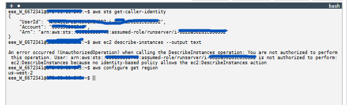
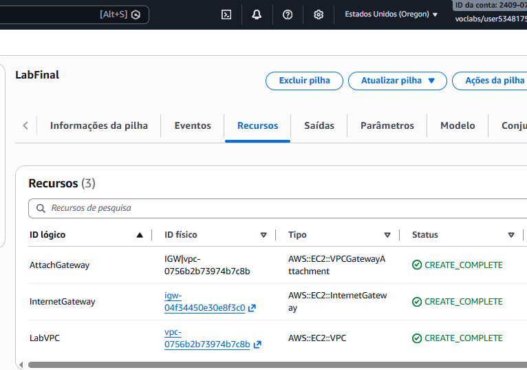
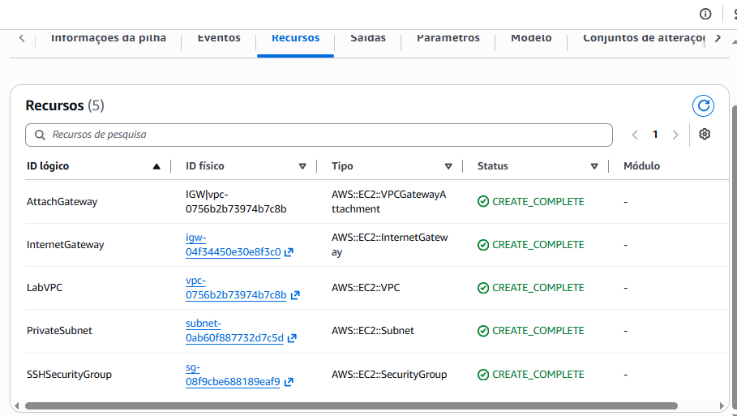
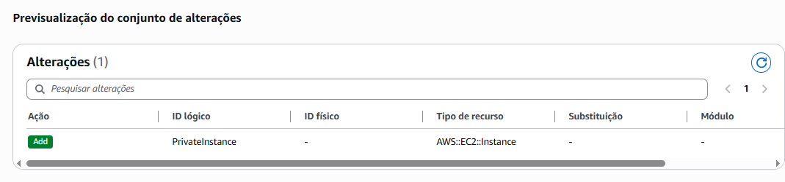
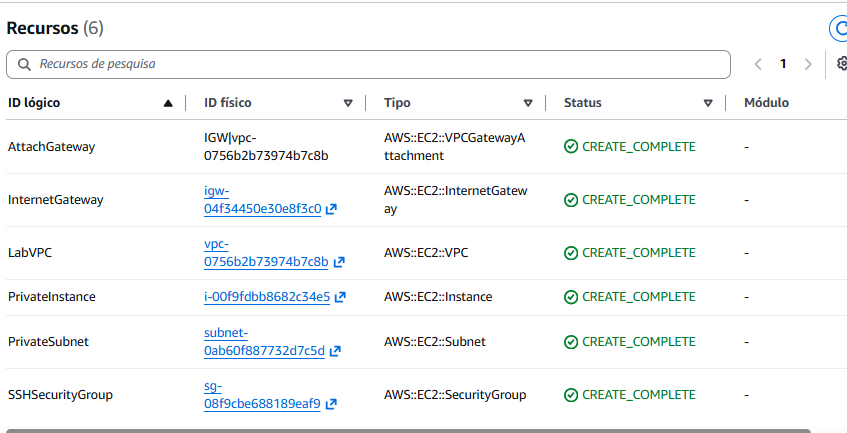
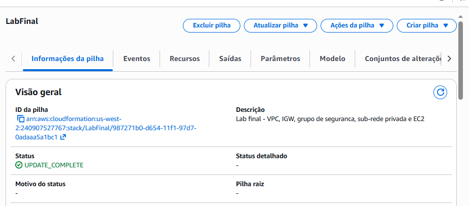
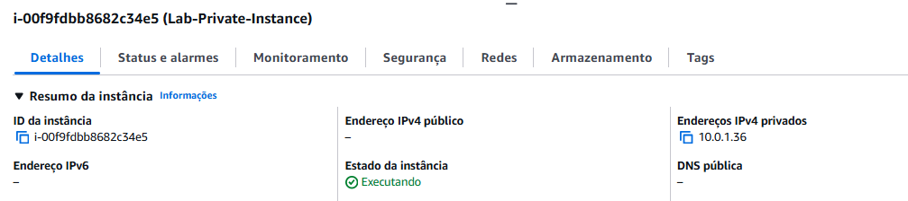
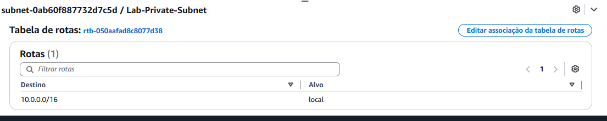
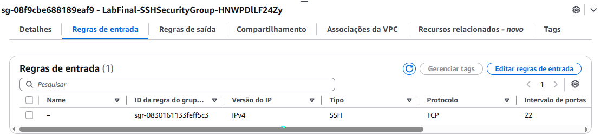

# Laboratório AWS: VPC e EC2 com AWS CloudFormation

Desafio final de **Infraestrutura como Código (IaC)** da Escola da Nuvem: escrever, do zero, um modelo do **AWS CloudFormation** (YAML) que cria uma rede completa e uma instância EC2, sem passo a passo pronto. O modelo foi construído **em etapas**, atualizando a mesma pilha a cada novo recurso.

---

## Objetivo

Criar um modelo do CloudFormation com os seguintes componentes:

- Uma **Amazon VPC**
- Um **gateway de internet** conectado à VPC
- Um **grupo de segurança** que permite **SSH (porta 22) de qualquer origem**
- Uma **sub-rede privada** dentro da VPC
- Uma **instância Amazon EC2 `t3.micro`** na sub-rede privada

> Não é necessário acessar a instância por SSH ou área de trabalho remota. O critério de sucesso é o modelo criar todos os recursos **sem erro**.

---

## Arquitetura

```
                 Internet
                    |
          [ Internet Gateway ]
                    |
 +------------------ Lab-VPC (10.0.0.0/16) ------------------+
 |                                                           |
 |   +------ Lab-Private-Subnet (10.0.1.0/24) ------+        |
 |   |  sem rota para o IGW | sem IP público        |        |
 |   |                                              |        |
 |   |   [ Lab-Private-Instance (t3.micro) ]        |        |
 |   |   Grupo de segurança: SSH 22 (0.0.0.0/0)     |        |
 |   +----------------------------------------------+        |
 +-----------------------------------------------------------+
```

**Serviços usados:** AWS CloudFormation, Amazon VPC, Amazon EC2, AWS Systems Manager (Parameter Store, para obter a AMI).

**Região:** `us-west-2` (Oregon)

---

## Como foi construído

A abordagem foi **iterativa**: cada etapa atualiza a pilha `LabFinal` e só segue para a próxima quando tudo está em `CREATE_COMPLETE`. Assim, se algo falhar, fica fácil achar o recurso responsável.

### Etapa 1: VPC e gateway de internet

Criação da pilha `LabFinal` com `AWS::EC2::VPC`, `AWS::EC2::InternetGateway` e `AWS::EC2::VPCGatewayAttachment`.

### Etapa 2: grupo de segurança e sub-rede privada

Atualização da pilha adicionando `AWS::EC2::SecurityGroup` (SSH na porta 22) e `AWS::EC2::Subnet`. O conjunto de alterações mostrou apenas os 2 recursos novos com ação **Add**.

### Etapa 3: instância EC2

Inclusão do parâmetro `AmazonLinuxAMIID` (que lê a AMI mais recente do Amazon Linux 2 no Systems Manager Parameter Store) e do recurso `AWS::EC2::Instance`, com `t3.micro` na sub-rede privada.

### Etapa 4: validação dos requisitos

Conferência pelo console de cada item do enunciado (resultado na seção abaixo).

---

## Modelo final (`template.yaml`)

```yaml
AWSTemplateFormatVersion: '2010-09-09'
Description: Lab final - VPC, IGW, grupo de seguranca, sub-rede privada e EC2

Parameters:
  AmazonLinuxAMIID:
    Type: AWS::SSM::Parameter::Value<AWS::EC2::Image::Id>
    Default: /aws/service/ami-amazon-linux-latest/amzn2-ami-hvm-x86_64-gp2

Resources:
  LabVPC:
    Type: AWS::EC2::VPC
    Properties:
      CidrBlock: 10.0.0.0/16
      EnableDnsSupport: true
      EnableDnsHostnames: true
      Tags:
        - Key: Name
          Value: Lab-VPC

  InternetGateway:
    Type: AWS::EC2::InternetGateway
    Properties:
      Tags:
        - Key: Name
          Value: Lab-IGW

  AttachGateway:
    Type: AWS::EC2::VPCGatewayAttachment
    Properties:
      VpcId: !Ref LabVPC
      InternetGatewayId: !Ref InternetGateway

  SSHSecurityGroup:
    Type: AWS::EC2::SecurityGroup
    Properties:
      GroupDescription: Permite SSH de qualquer lugar
      VpcId: !Ref LabVPC
      SecurityGroupIngress:
        - IpProtocol: tcp
          FromPort: 22
          ToPort: 22
          CidrIp: 0.0.0.0/0
      Tags:
        - Key: Name
          Value: Lab-SSH-SG

  PrivateSubnet:
    Type: AWS::EC2::Subnet
    Properties:
      VpcId: !Ref LabVPC
      CidrBlock: 10.0.1.0/24
      MapPublicIpOnLaunch: false
      Tags:
        - Key: Name
          Value: Lab-Private-Subnet

  PrivateInstance:
    Type: AWS::EC2::Instance
    Properties:
      ImageId: !Ref AmazonLinuxAMIID
      InstanceType: t3.micro
      SubnetId: !Ref PrivateSubnet
      SecurityGroupIds:
        - !Ref SSHSecurityGroup
      Tags:
        - Key: Name
          Value: Lab-Private-Instance
```

### Decisões do modelo

- **Sub-rede privada:** ela é privada porque **não tem rota para o gateway de internet** (só a rota `local`) e não atribui IP público (`MapPublicIpOnLaunch: false`).
- **AMI via parâmetro:** o tipo `AWS::SSM::Parameter::Value<AWS::EC2::Image::Id>` busca a AMI mais recente da Região, sem fixar um ID no modelo.
- **Referências com `!Ref`:** os recursos se ligam por referência (VPC, sub-rede e grupo de segurança), e o CloudFormation resolve sozinho a ordem de criação.

---

## Validação dos requisitos

| Requisito | Evidência | Resultado |
|---|---|---|
| Amazon VPC | `Lab-VPC` criada | ✅ |
| Gateway de internet conectado à VPC | `InternetGateway` e `AttachGateway` em `CREATE_COMPLETE` | ✅ |
| Grupo de segurança com SSH de qualquer lugar | Regra de entrada SSH, TCP, porta 22, origem `0.0.0.0/0` | ✅ |
| Sub-rede privada | `Lab-Private-Subnet` apenas com a rota `10.0.0.0/16 → local` | ✅ |
| EC2 `t3.micro` na sub-rede privada | IP privado `10.0.1.36`, sem IPv4 público, estado Executando | ✅ |
| Modelo criado sem erro | Pilha `LabFinal` com status `UPDATE_COMPLETE` (6 recursos) | ✅ |

---

## Prints do laboratório

> Coloque as imagens na pasta `prints/` e ajuste os nomes, se necessário.

| Etapa | Print |
|---|---|
| Região e terminal do laboratório |  |
| Pilha com VPC e gateway de internet |  |
| Grupo de segurança e sub-rede privada |  |
| Pré-visualização do conjunto de alterações (EC2) |  |
| Pilha com os 6 recursos |  |
| Pilha `UPDATE_COMPLETE` |  |
| Detalhes da instância (`t3.micro`, sem IP público) | |
| Tabela de rotas da sub-rede privada |  |
| Regras de entrada do grupo de segurança |  |

---

## Aprendizados

- Construir a infraestrutura **por etapas** e atualizar a pilha com **conjuntos de alterações** deixa claro o que será adicionado antes de aplicar.
- O CloudFormation **resolve dependências** (VPC antes da sub-rede, sub-rede antes da instância) a partir das referências `!Ref`.
- A diferença entre sub-rede pública e privada está na **tabela de rotas** (rota para o gateway de internet) e na atribuição de IP público.
- No YAML, a **indentação** importa: 2 espaços por nível, nunca Tab.
- **Boa prática de segurança:** o laboratório pede SSH aberto para `0.0.0.0/0`. Em ambientes reais, a origem deve ser restrita (IP específico, VPN ou o uso do AWS Systems Manager Session Manager).

---

## Limpeza

Para evitar custos fora do ambiente do laboratório, exclua a pilha: o CloudFormation remove todos os recursos criados por ela.

```bash
aws cloudformation delete-stack --stack-name LabFinal
```

---

## Autora

**LUCIANA RB DE ASSIS**
Em transição de carreira para Engenharia de Dados

- LinkedIn: [linkedin.com/in/lucianarbassis](https://www.linkedin.com/in/lucianarbassis/)
- GitHub: [github.com/alra-code](https://github.com/alra-code)
